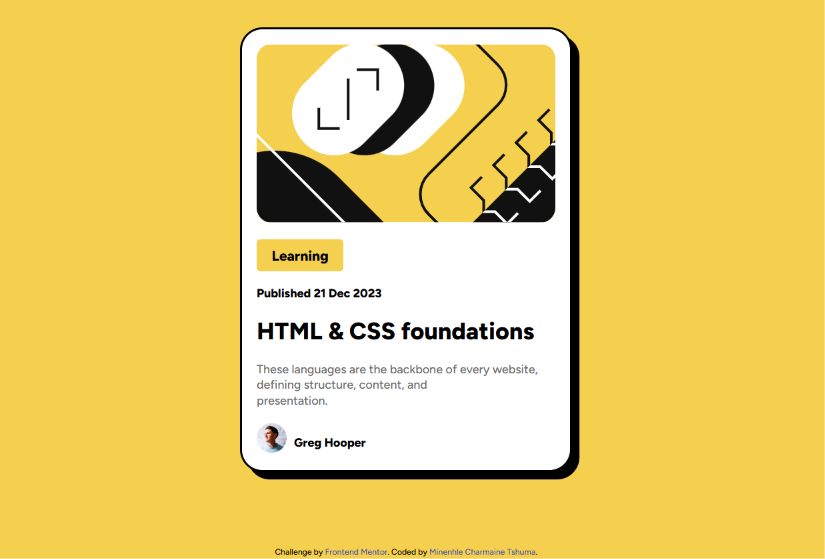

# Frontend Mentor - Blog preview card solution

This is a solution to the [Blog preview card challenge on Frontend Mentor](https://www.frontendmentor.io/challenges/blog-preview-card-ckPaj01IcS). Frontend Mentor challenges help you improve your coding skills by building realistic projects. 

## Table of contents

- [Overview](#overview)
  - [The challenge](#the-challenge)
  - [Screenshot](#screenshot)
  - [Links](#links)
- [My process](#my-process)
  - [Built with](#built-with)
  - [What I learned](#what-i-learned)
  - [Continued development](#continued-development)
  - [Useful resources](#useful-resources)
  - [AI Collaboration](#ai-collaboration)
- [Author](#author)


## Overview

### The challenge

Users should be able to:

- See hover and focus states for all interactive elements on the page

### Screenshot




### Links

- Solution URL: (https://github.com/mtshuma16-crypto/blog-preview-card)
- Live Site URL: (https://mtshuma16-crypto.github.io/blog-preview-card/)

## My process

### Built with

- Semantic HTML5 markup
- CSS 
- Flexbox


### What I learned

I learned how to use the Box-shadow Property, it accepts between two and six values which are "inset, horizontal offset, vertical offset, blur radius, spread radius and color". I got an apportunity to also compare Bow-shadow with Drop-shadow (content shasdow).

I had to find a way of reducing font size for smaller screens without using media queries, that is when i learnt about the Clamp value.


```css
body{
    background-color: hsl(47, 88%, 63%);
    font-size:clamp(0.6875rem, 0.5775rem + 0.4695vw, 1rem);
    font-family:'figtree', sans-serif;
}
```


### Continued development

Arears that i want to continue focusing on in the future projects.

 1.Focus state.
 2.Css custom properties, how to create one and why.
 3.Creating a .gitignore file and what type of flies are to be stored inside.


### Useful resources

- [Box-shadow and filter: drop-shadow () by Kevin Powell](https://youtu.be/8Z9zimqUCzA) - This helped me with understanding the difference between the two and when to use the properties.I really liked how he explains the concepts, it was easy to understand for a begginer like me.
- [How to convert a maximum pixel font size into a viewport](https://utopia.fyi/clamp/calculator?a=360,1240) - This is an amazing site which helped me understand about the Clamp value. I'd recommend it to anyone still learning this concept.


### AI Collaboration

Describe how you used AI tools (if any) during this project. This helps demonstrate your ability to work effectively with AI assistants.

- I used Gemini 4 Hydrogen.
- I used it to brainstorm solutions on how to find the Clamp values to use on reducing the font size for smaller screens.
- I came across a site that helps with the calculations known as Utopia Fluid Type Scale Calculator.


## Author

- Website - [blog-preview-card](https://github.com/mtshuma16-crypto/blog-preview-card)
- Frontend Mentor - [@mtshuma16-crypto](https://www.frontendmentor.io/profile/mtshuma16-crypto)


